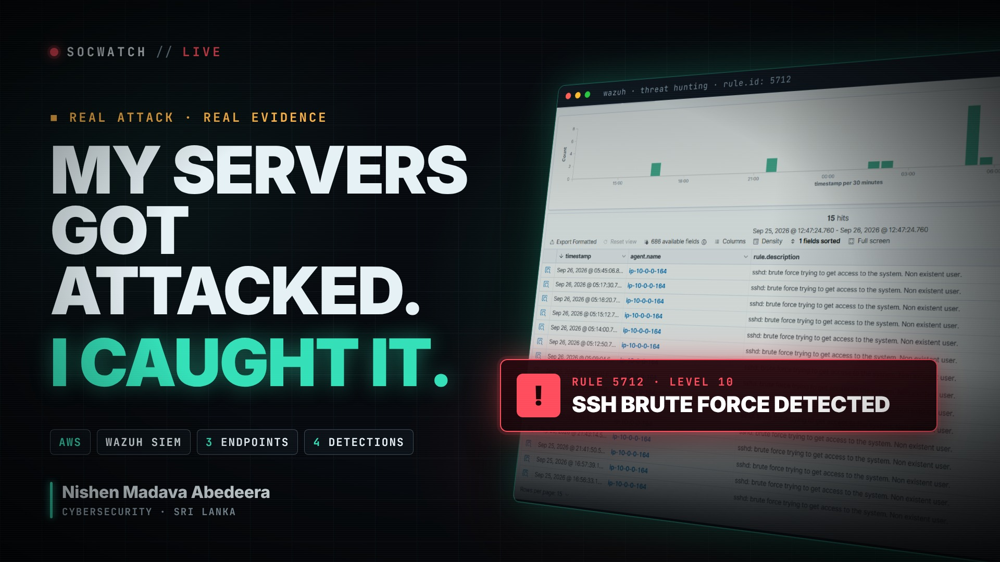

# SOCWatch — Wazuh SOC Monitoring Lab

<p align="center">
  
</p>


> **TL;DR** — A cloud SOC lab: 1 Wazuh manager + 3 monitored endpoints on AWS, proving log ingestion, file-integrity monitoring, vulnerability detection and brute-force detection with real captured evidence.

## 🎬 Watch the 60-second demo

https://github.com/user-attachments/assets/fa51d437-d311-4568-961f-0ebc60ce3674

<sub>▶ Press play — architecture, log ingestion, FIM, CVE detection and a real SSH brute-force alert (Rule 5712, level 10). Full-size file: <a href="media/socwatch-promo.mp4">media/socwatch-promo.mp4</a></sub>

**Author:** Nishen Madava Abedeera  
**Project:** CCA Cyber Security Internship — 8-week individual project  
**Status:** Weeks 1–7 substantively complete; Week 8 (live demonstration) remaining (~97% overall)

## Overview

SOCWatch is a hands-on Security Operations Center (SOC) monitoring lab built on AWS using
[Wazuh](https://wazuh.com/). It stands up one Wazuh manager and three monitored endpoints
(Ubuntu, Debian, Windows Server) and proves four real detection use cases end-to-end:

1. **Log ingestion** — centralized log collection from all endpoints
2. **File Integrity Monitoring (FIM)** — real-time create/modify/delete detection with hash diffs
3. **Vulnerability detection** — CVE feed scanning against installed packages
4. **Authentication-failure / brute-force detection** — single and correlated alert rules

All four use cases are backed by real captured evidence (dashboard screenshots, raw alert logs,
rule IDs), not simulated data — including a genuine internet-sourced brute-force attack the lab
picked up during evidence capture.

## Repository structure

```
├── CCA_Cyber_Security_Internship_Project_Brief.pdf   # Original assignment brief
├── SOCWatch_Runbook.md                                # Full week-by-week build runbook
├── SOCWatch-Installation-and-Project-Guide.docx/.pdf   # Full project report
├── SOCWatch-Presentation-Draft.pptx                    # Presentation deck
├── SOCWatch.pdf                                        # Report export
└── SOCWatch-Evidence/SOCWatch-Evidence/
    ├── week1 .. week8/     # Per-week evidence, checklists, screenshots
    ├── diagrams/           # Architecture diagrams
    ├── infra/              # Terraform (reference only — lab was provisioned via AWS Console)
    ├── scripts/            # Report/deck generator scripts
    ├── report/             # Synced copy of the report deliverables
    ├── instance-inventory.md
    └── troubleshooting-log.md
```

## Weekly progress log

| Week | Focus | Status |
|------|-------|--------|
| 1 | Scope, architecture diagram, risk register | ✅ Done |
| 2 | AWS foundation (VPC, security groups, IAM, root MFA, budget) | ✅ Done |
| 3 | Wazuh manager install | ✅ Done |
| 4 | Agent enrolment (Ubuntu, Debian, Windows) | ✅ Done — all 3 agents Active |
| 5 | File Integrity Monitoring use case | ✅ Done |
| 6 | Vulnerability detection + auth-failure/brute-force use cases | ✅ Done |
| 7 | Report, presentation, evidence consolidation | ✅ Done |
| 8 | Live demonstration | ⏳ Remaining |

Detailed, dated progress notes for every session are in `SOCWatch-Evidence/SOCWatch-Evidence/troubleshooting-log.md`
and the per-week folders. See [`SCHEDULE.md`](./SCHEDULE.md) for the ongoing update cadence.

## Security note

This is a defensive/educational lab. Before publishing, all AWS/Wazuh credentials and the AWS
IAM Access Key ID were removed or redacted from tracked files — see `.gitignore`. Live
credential files, Terraform state, and the Terraform provider cache are never committed.
The lab's security group intentionally uses broad inbound rules for demo-access reliability
(documented tradeoff, see the troubleshooting log) — SSH key and dashboard authentication remain
the actual access controls, and this is torn down/narrowed after grading.

## License

© Nishen Madava Abedeera. Coursework project for the CCA Cyber Security Internship programme.
